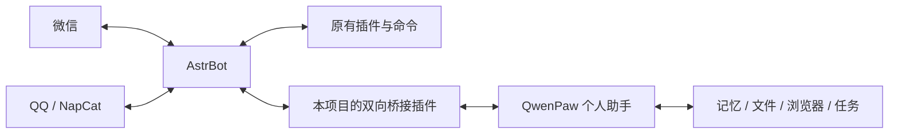

# AstrBot × QwenPaw × NapCat

让微信和 QQ 中的 AstrBot 使用 QwenPaw 的记忆、任务、文件与浏览器能力，同时保留 AstrBot 的插件生态。

这是独立维护的**社区集成项目**，不是上游团队的官方合并发行版。当前版本 **0.5.0-alpha**，固定适配 AstrBot **4.25.1**、QwenPaw **2.2.1** 与 NapCat **4.18.33**。

## 它能做什么

- **聊天互通：** 消息和附件由 AstrBot 接收，交给 QwenPaw 助手处理，再回复原会话。普通 AstrBot 插件命令继续使用。
- **个人记忆：** 按用户分配助手与工作区；私聊和群聊分开。支持手动保存、更正、删除备注，接入 QwenPaw 原生记忆检索；自动提炼需要有效模型。
- **跨平台绑定：** 经两个已授权账号的私聊确认，让微信与 QQ 共用个人助手。不会静默合并已有的独立记忆。
- **工具协作：** QwenPaw 可以调用管理员明确放行、当前消息可用的 AstrBot 模型工具。并非所有插件都会自动变成工具。
- **文件和浏览器：** 处理个人工作区及会话附件；使用按助手隔离的结构化浏览器打开、阅读、点击和填写网页。
- **主动任务：** 在 QwenPaw 原生后台创建任务，按保存的会话路由回传结果；需要审核的操作回到原会话确认。
- **本机统一入口：** 同一个地址切换三套原生后台，保留它们原来的配置能力。



## 下载

在 [GitHub Releases](https://github.com/misaki-mei-yue/astrbot-qwenpaw/releases) 下载 `astrbot-qwenpaw-0.5.0-alpha.zip`，解压后使用；同页提供 `SHA256SUMS` 校验值。源码包包含启动脚本，不包含上游镜像或任何预设账号。

## Windows 快速开始

需要 **Docker Desktop（Linux 容器）**、**Python 3.10+** 与网络连接。首次启动会下载上游镜像；本仓库不附带这些镜像或预装账号。

1. 下载或克隆完整仓库，放在普通文件夹中。程序数据保存在该目录的 `runtime`；Docker 镜像和缓存的位置由 Docker Desktop 设置决定。
2. 启动 Docker Desktop，双击 **`start.cmd`**。
3. 启动完成后打开 **http://localhost:18080/**。
4. 在 QwenPaw 中配置模型并选择默认模型；在 AstrBot 配置微信，或在 NapCat 扫码登录 QQ。
5. 向机器人发送 **`/paw whoami`**，将返回的用户 ID 加入 AstrBot 桥接插件的允许列表，再测试对话。

以后双击 `start.cmd` 启动，双击 `stop.cmd` 停止本项目，保留配置与数据。详见 [Windows 说明](docs/windows.md)、[QQ 接入](docs/qq.md)和 [QwenPaw 配置](docs/qwenpaw.md)。

默认拉取固定版本镜像，只构建轻量入口服务。需要从固定源码构建 QwenPaw 时，显式运行 `start.cmd -BuildQwenPaw`；它不是默认步骤，也不构建 NapCat 源码。

## 第一次使用记忆

在已授权的私聊中发送：

```text
/paw remember 我喜欢简洁的中文回答
/paw memory
/paw status
```

`/paw new` 开始新对话并保留长期记忆。需要绑定另一个平台时，先发送 `/paw link`，按回复在另一个已授权的私聊中兑换绑定码。详细行为与删除范围见[个人助手说明](docs/personal-memory.md)。

自动记忆、工具调用和图片理解取决于模型及提供商能力。配置成功或页面可打开，不代表这些功能已经完成实际验收。

## Linux 与服务器

提供 Docker Compose、全新安装和已有 AstrBot 加装的准备脚本，见[部署说明](docs/deployment.md)。**目前服务器流程需要手动检查配置并执行 Compose 命令**，准备脚本本身不代表三套程序已经启动，也不自动配置域名或 HTTPS。

浏览器和并发任务会增加资源消耗。按实际任务设置内存、交换空间和并发限额，再决定服务器配置。本机统一入口只监听 `127.0.0.1:18080`，不要直接作为公网管理入口使用。

## 已知边界

- 这是公开测试版。真实模型的自动记忆质量、微信／QQ 送达以及第三方插件需要分别验证。
- 原生后台分别管理登录与配置；统一入口没有把三套账号变成统一登录。
- 工具守卫提供路径和身份检查，**不等于操作系统级多租户沙箱**。个人助手不开放任意 shell、任意代码浏览器或跨助手操作。
- 结构化浏览器不接管宿主机已登录的浏览器，当前不提供文件上传、下载和持久登录资料。
- 定时任务不能借用已经结束的 AstrBot 消息来调用插件工具。失败任务不自动重复提交。
- 发布内容不包含运行目录、密钥、聊天记录、个人记忆、QQ 登录资料或浏览器资料。

## 开发

```sh
python -m pip install -r requirements-dev.txt
python -m unittest discover -s tests -v
```

测试包括协议替身、权限与路径边界，并提供上游原生运行时检查脚本。涉及 Docker、浏览器或模型的检查有各自环境要求；单元测试不代替真实平台验收。参见[架构](docs/architecture.md)、[验证说明](docs/validation.md)和[安全说明](SECURITY.md)。

## 许可与上游

本仓库独立编写的集成代码采用 **AGPL-3.0-or-later**，见 [LICENSE](LICENSE) 与 [COPYRIGHT.md](COPYRIGHT.md)。

[AstrBot](https://github.com/AstrBotDevs/AstrBot)、[QwenPaw](https://github.com/agentscope-ai/QwenPaw)、[NapCatQQ](https://github.com/NapNeko/NapCatQQ) 及其镜像、依赖保留各自许可。特别是 **NapCat 4.18.33 使用有限再分发及非商业许可，不能把整个组合统一视为 AGPL 或不受限制的开源软件**。本仓库引用外部镜像，不重新发布 NapCat 源码、修改版或镜像。使用前请阅读[第三方说明](THIRD_PARTY_NOTICES.md)。

项目地址：[astrbot-qwenpaw](https://github.com/misaki-mei-yue/astrbot-qwenpaw)。报告问题时请去除日志中的密钥、账号、聊天与个人文件内容。

社区友链：[LINUX DO](https://linux.do/)
